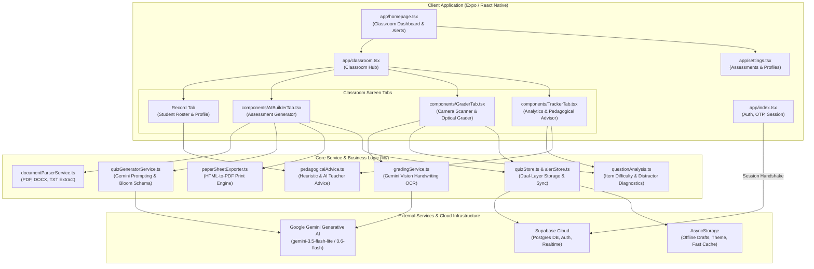
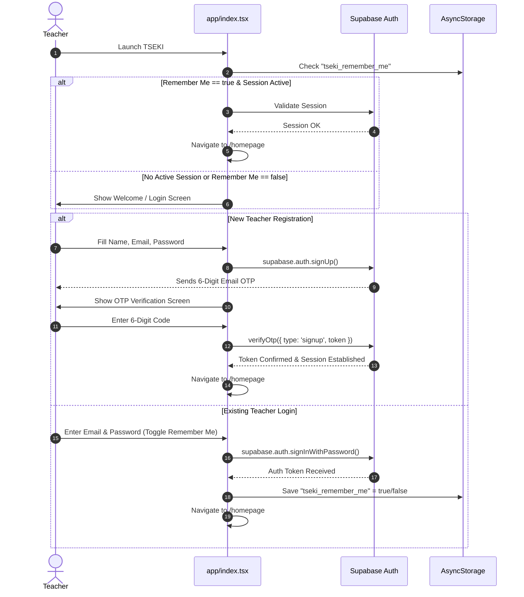
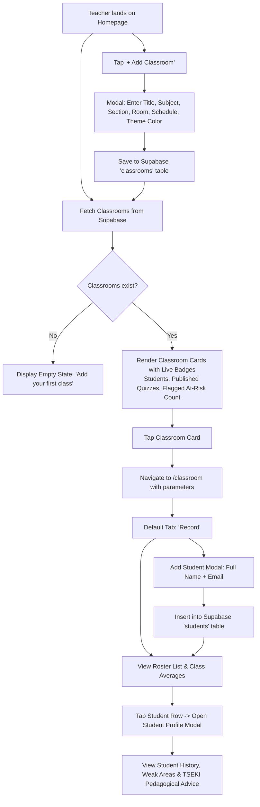
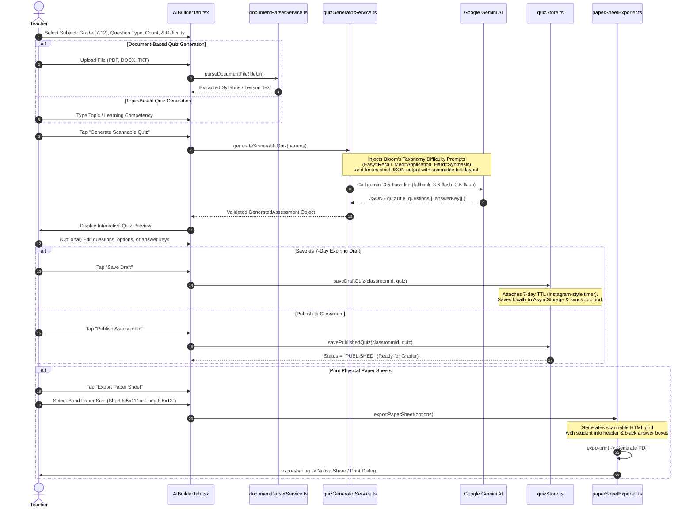
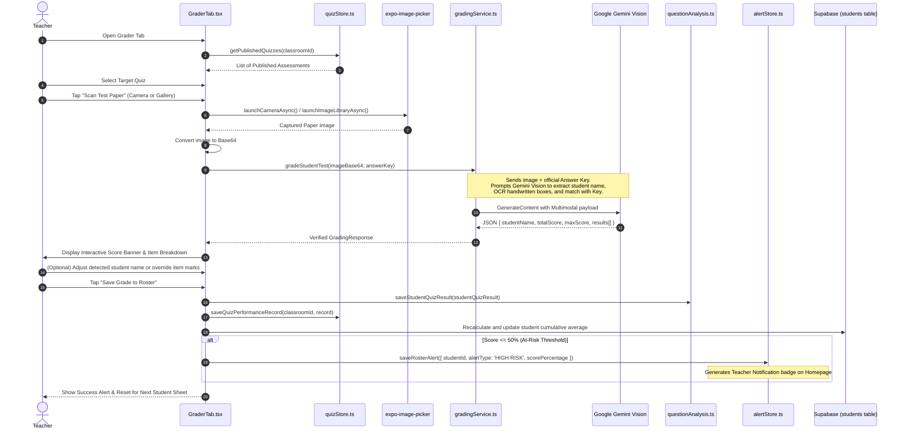
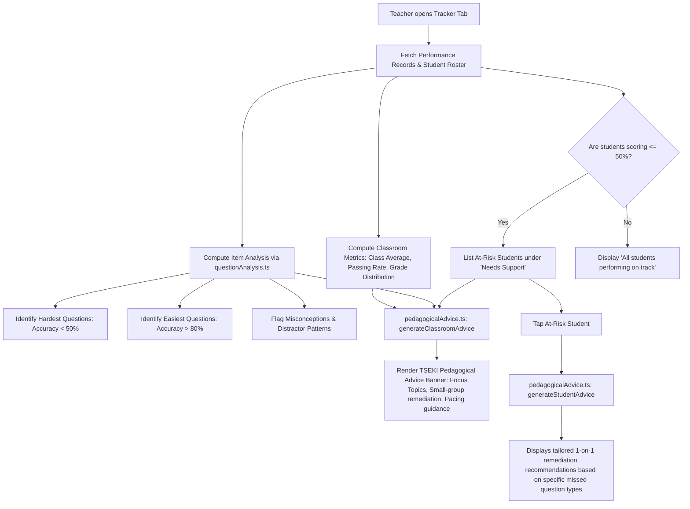
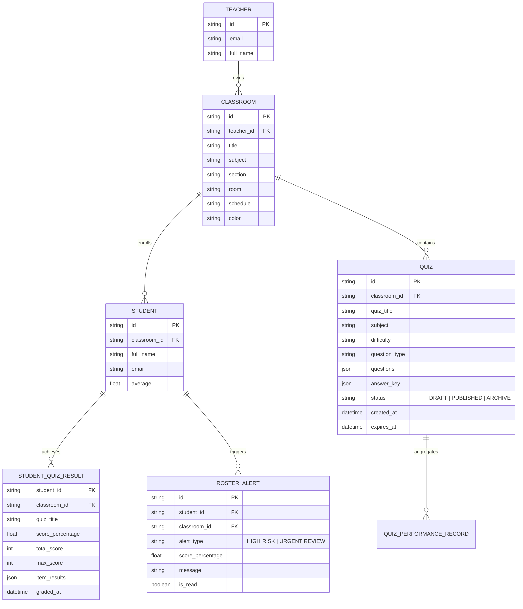

# TSEKI (Check) - Program Workflow & System Architecture

> **Version:** 1.0.0  
> **Framework:** Expo SDK 54 / React Native 0.81  
> **Backend & Auth:** Supabase (PostgreSQL, Auth, Realtime)  
> **AI Engine:** Google Gemini AI (`gemini-3.5-flash-lite`, `gemini-3.6-flash`, `gemini-2.5-flash`)  
> **Storage & Cache:** AsyncStorage + Supabase Cloud Sync  

---

## 1. Executive Summary

**TSEKI** (a play on the Filipino word *"Tseki"* meaning "Check" / "Mark") is an intelligent, offline-capable mobile platform designed for teachers. It streamlines the full teaching-assessment lifecycle:
1. **Curriculum & Assessment Creation:** AI-assisted quiz generation from prompts or uploaded curriculum documents (PDF, DOCX, TXT), calibrated according to Bloom's Taxonomy.
2. **Standardized Paper Generation:** Formats assessments into printable bond-paper worksheets (Short 8.5×11" or Long 8.5×13") equipped with machine-readable, optical answer boxes.
3. **AI Vision Camera Grading:** Automated mobile grading that reads handwritten answers directly from physical test sheets via Gemini Multimodal Vision, matching them against digital answer keys with manual teacher override.
4. **Pedagogical Analytics & Diagnostics:** Instant item analysis (difficulty index, question-type breakdown) and actionable pedagogical guidance tailored for individual at-risk students and entire classrooms.

---

## 2. High-Level Architecture Diagram



---

## 3. End-to-End Program Workflows

### 3.1 Workflow 1: Authentication & Teacher Onboarding
Controls teacher identity, persistent sessions, and secure verification.



---

### 3.2 Workflow 2: Classroom & Roster Management
Manages classes, subject sections, and student rosters.



---

### 3.3 Workflow 3: AI Assessment Generation & Paper Sheet Export (`AIBuilderTab`)
Generates pedagogical quizzes using Google Gemini AI, formats them with scannable answer boxes, and exports printable bond-paper PDFs.



---

### 3.4 Workflow 4: Optical Scanning & AI Test Grading (`GraderTab`)
Automates paper grading using on-device cameras and Gemini Vision OCR.



---

### 3.5 Workflow 5: Diagnostic Item Analysis & Pedagogical Advice (`TrackerTab`)
Transforms raw test results into actionable instructional insights.



---

### 3.6 Workflow 6: Centralized Assessment Lifecycle & Settings (`SettingsScreen`)
Oversees global preferences, account credentials, and cross-classroom assessments.

```mermaid
flowchart TD
    A[Teacher opens Settings] --> B{Choose Setting Action}
    
    B --> C[Manage Profile]
    C --> C1[Edit Display Name -> supabase.auth.updateUser]
    C --> C2[Change Password -> supabase.auth.updateUser]
    
    B --> D[Theme Settings]
    D --> D1[Toggle Light / Dark Mode]
    D1 --> D2[Save preference to AsyncStorage & update ThemeContext]
    
    B --> E[Centralized Assessments Drawer]
    E --> E1[Drafts Tab]
    E1 --> E2[Shows All Drafts across all classes with 7-Day Countdown Badges]
    E2 --> E3[Actions: Inspect Questions, Publish Draft, Delete Draft]
    
    E --> E4[Archive / Published Tab]
    E4 --> E5[Shows All Historical Assessments]
    E5 --> E6[Actions: Inspect Question Breakdown, Re-export Bond Paper PDF, Delete Quiz]

    B --> F[Sign Out]
    F --> F1[Clear 'tseki_remember_me' from AsyncStorage]
    F1 --> F2[supabase.auth.signOut()]
    F2 --> F3[Redirect to Welcome Screen]
```

---

## 4. Key Data Entities & Relationship Schema



---

## 5. Technical Specifications & Design Decisions

| Subsystem | Technology / Package | Design Rationale |
| :--- | :--- | :--- |
| **Routing & Navigation** | `expo-router` v6 | File-based routing with native stack navigation, matching modern Expo standards. |
| **Styling & Theming** | Vanilla StyleSheet + `ThemeContext` | Light / Dark mode with high-contrast Orange (`#FF6B00`) branding, avoiding heavy utility overhead. |
| **Cloud Database & Auth** | `@supabase/supabase-js` | Instant email OTP authentication, relational tables, and row-level security for multi-tenant teachers. |
| **Local Cache & Offline** | `@react-native-async-storage/async-storage` | Seamless offline-first access for draft assessments, theme preferences, and cached classroom alerts. |
| **AI Generation & Vision** | `@google/generative-ai` | Multimodal model cascade (`gemini-3.5-flash-lite`, `gemini-3.6-flash`, `gemini-2.5-flash`) providing high-speed OCR and pedagogical item synthesis. |
| **Document Ingestion** | `expo-document-picker` + `documentParserService` | Ingests PDF syllabus guidelines, Word docs, and lesson notes to ground AI assessments in teacher-provided curricula. |
| **Physical Paper Generation** | `expo-print` + `expo-sharing` | Standardized bond-paper printing (Short 8.5×11" / Long 8.5×13") with clean optical square grids for consistent camera recognition. |
| **Optical Grading** | `expo-image-picker` + `gradingService` | Captures papers via phone camera, extracts handwritten student responses within bounding boxes, and cross-checks with answer keys. |

---

## 6. Error Handling & Reliability Measures

1. **AI Model Cascade & Fallback:**  
   If the primary `gemini-3.5-flash-lite` encounters rate limits or service interruptions, requests automatically cascade to `gemini-3.6-flash` and `gemini-2.5-flash`.
2. **Deterministic Grading Mathematical Guarantee:**  
   The scoring engine recalculates all points awarded on the client to guarantee mathematical consistency between the score banner and individual item markings.
3. **7-Day Draft Auto-Expiry Lifecycle:**  
   Unpublished drafts enforce a strict 7-day TTL countdown badge to avoid local memory leaks and obsolete assessment accumulation.
4. **Offline Resilience:**  
   Assessment drafts and alert states are stored in AsyncStorage, preserving teacher progress even during network dropouts.
