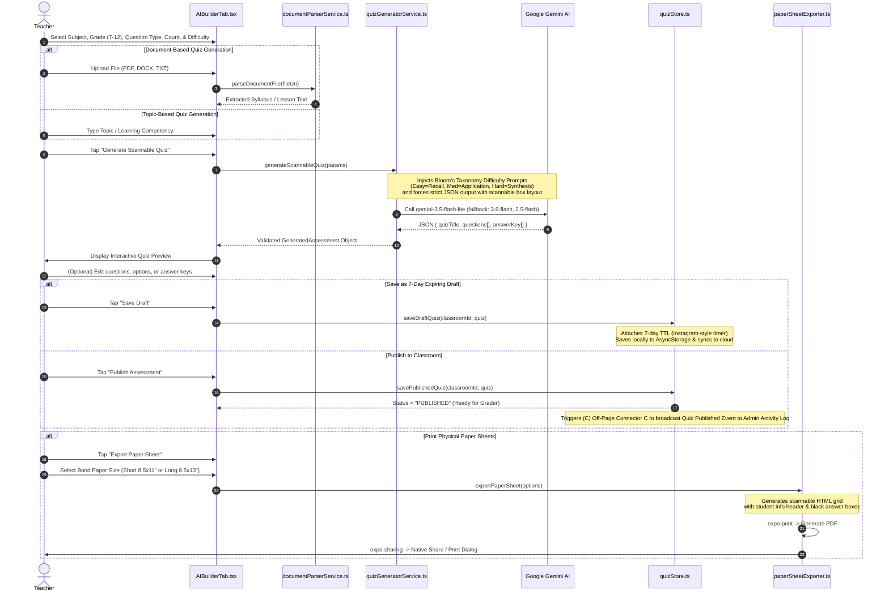
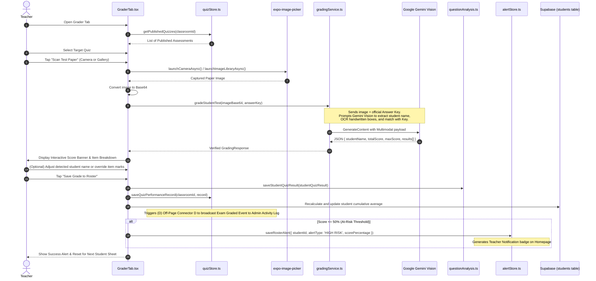
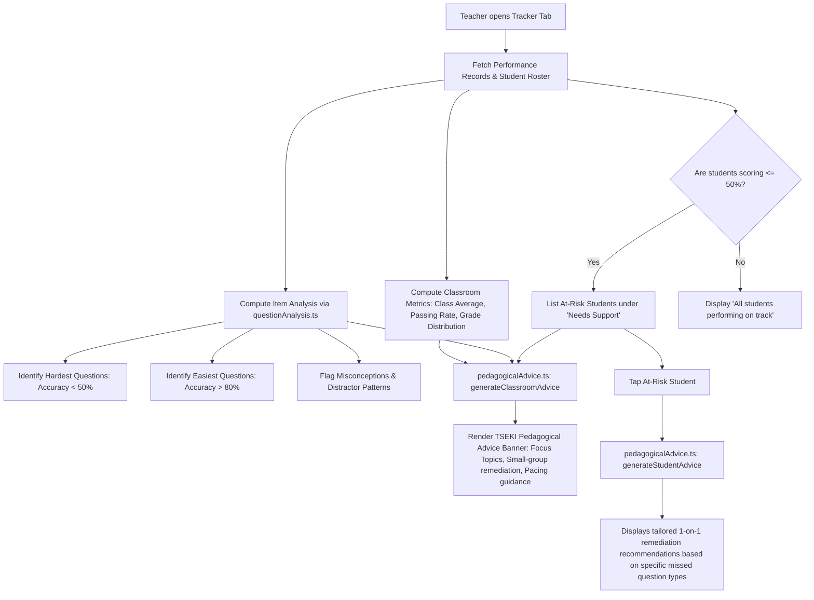
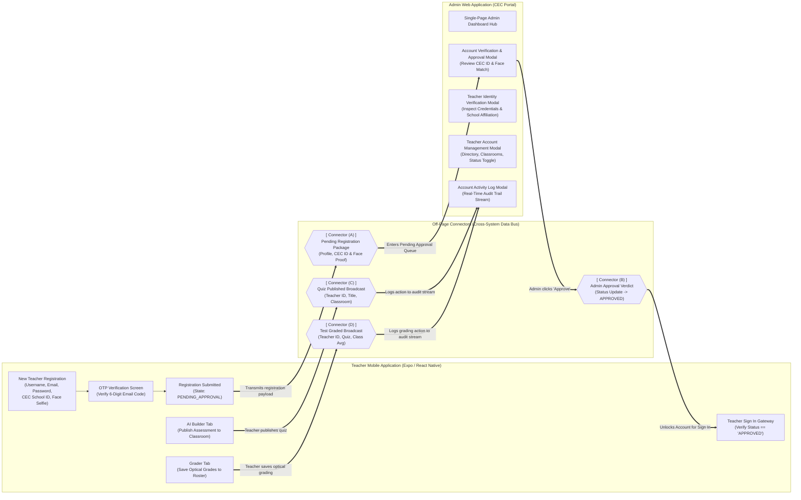
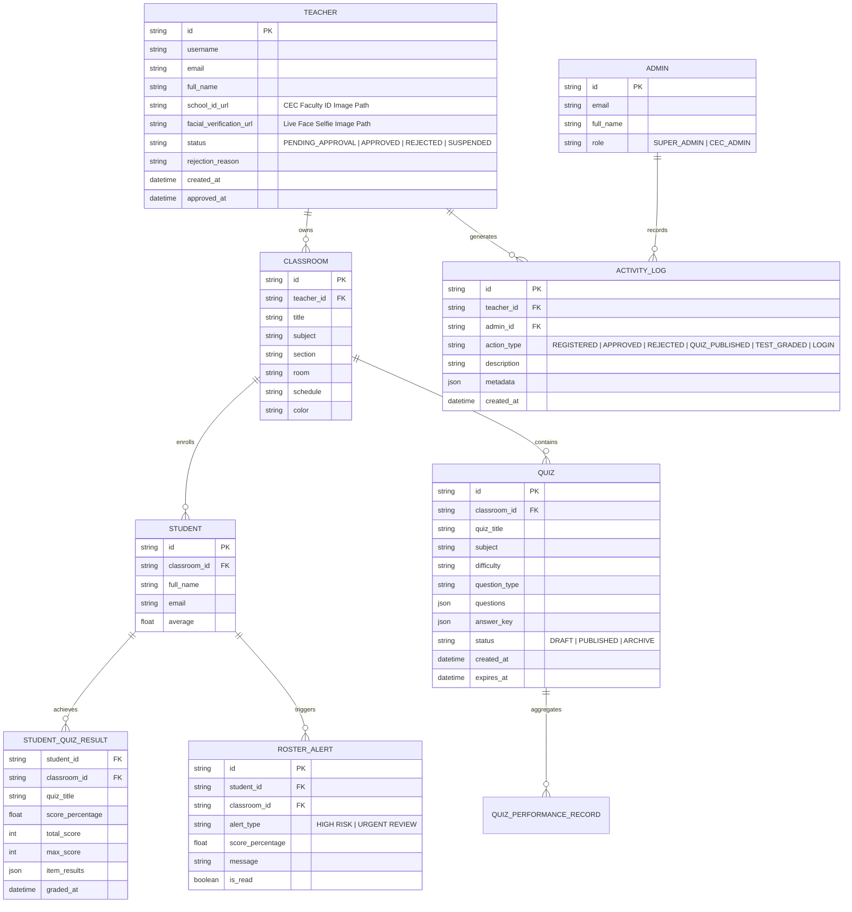
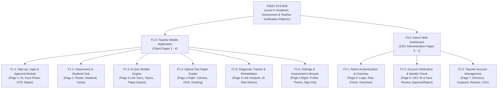

# TSEKI (Check) - Program Workflow & System Architecture

> **Version:** 1.0.0  
> **Framework:** Expo SDK 54 / React Native 0.81  
> **Backend & Auth:** Supabase (PostgreSQL, Auth, Realtime)  
> **AI Engine:** Google Gemini AI (`gemini-3.5-flash-lite`, `gemini-3.6-flash`, `gemini-2.5-flash`)  
> **Storage & Cache:** AsyncStorage + Supabase Cloud Sync  

---

## 1. Executive Summary

**TSEKI** (a play on the Filipino word *"Tseki"* meaning "Check" / "Mark") is an intelligent, offline-capable mobile platform designed for teachers. It streamlines the full teaching-assessment lifecycle:
1. **Curriculum & Assessment Creation:** AI-assisted quiz generation from prompts or uploaded curriculum documents (PDF, DOCX, TXT), calibrated according to Bloom's Taxonomy.
2. **Standardized Paper Generation:** Formats assessments into printable bond-paper worksheets (Short 8.5×11" or Long 8.5×13") equipped with machine-readable, optical answer boxes.
3. **AI Vision Camera Grading:** Automated mobile grading that reads handwritten answers directly from physical test sheets via Gemini Multimodal Vision, matching them against digital answer keys with manual teacher override.
4. **Pedagogical Analytics & Diagnostics:** Instant item analysis (difficulty index, question-type breakdown) and actionable pedagogical guidance tailored for individual at-risk students and entire classrooms.

---

## 2. High-Level Architecture Diagram

```mermaid
graph TD
    subgraph MOBILE_UI ["Client Application (Mobile App - Expo / React Native)"]
        AUTH["app/index.tsx<br/>(Auth, CEC School ID, Face Verify, OTP)"]
        HOME["app/homepage.tsx<br/>(Classroom Dashboard & Alerts)"]
        CLASS["app/classroom.tsx<br/>(Classroom Hub)"]
        SETTINGS["app/settings.tsx<br/>(Assessments & Profiles)"]

        subgraph TABS ["Classroom Screen Tabs"]
            TAB_RECORD["Record Tab<br/>(Student Roster & Profile)"]
            TAB_BUILDER["components/AIBuilderTab.tsx<br/>(Assessment Generator)"]
            TAB_GRADER["components/GraderTab.tsx<br/>(Camera Scanner & Optical Grader)"]
            TAB_TRACKER["components/TrackerTab.tsx<br/>(Analytics & Pedagogical Advisor)"]
        end
    end

    subgraph ADMIN_UI ["Admin Web Application (CEC Administration Portal)"]
        ADMIN_DASH["Admin Dashboard Hub (Single-Page View)<br/>Click Feature Card to Expand Data"]
        MODAL_APPROVE["Account Verification & Approval Modal<br/>(CEC ID & Face Match Review Queue)"]
        MODAL_IDENTITY["Teacher Identity Verification Modal<br/>(Submitted CEC Document Inspection)"]
        MODAL_MGMT["Teacher Account Management Modal<br/>(Active / Suspended / Teacher Master List)"]
        MODAL_LOGS["Account Activity Log Modal<br/>(Quiz Published, Grading, Audit Trail)"]
    end

    subgraph SERVICE_LAYER ["Core Service & Business Logic (lib/)"]
        PARSER["documentParserService.ts<br/>(PDF, DOCX, TXT Extract)"]
        GENERATOR["quizGeneratorService.ts<br/>(Gemini Prompting & Bloom Schema)"]
        EXPORTER["paperSheetExporter.ts<br/>(HTML-to-PDF Print Engine)"]
        GRADING["gradingService.ts<br/>(Gemini Vision Handwriting OCR)"]
        ADVICE["pedagogicalAdvice.ts<br/>(Heuristic & AI Teacher Advice)"]
        ANALYSIS["questionAnalysis.ts<br/>(Item Difficulty & Distractor Diagnostics)"]
        STORE["quizStore.ts & alertStore.ts<br/>(Dual-Layer Storage & Sync)"]
    end

    subgraph BACKEND_LAYER ["External Services & Cloud Infrastructure"]
        GEMINI["Google Gemini Generative AI<br/>(gemini-3.5-flash-lite / 3.6-flash)"]
        SUPABASE["Supabase Cloud<br/>(Postgres DB, Auth, Realtime)"]
        STORAGE["Supabase Storage<br/>(School IDs, Face Captures, Question Papers)"]
        LOCAL_STORAGE["AsyncStorage<br/>(Offline Drafts, Theme, Fast Cache)"]
    end

    %% Mobile App Connections
    AUTH -->|Session Handshake & Verification Upload| SUPABASE
    AUTH -->|Upload CEC ID & Face Capture| STORAGE
    HOME --> CLASS
    HOME --> SETTINGS
    CLASS --> TAB_RECORD
    CLASS --> TAB_BUILDER
    CLASS --> TAB_GRADER
    CLASS --> TAB_TRACKER

    TAB_BUILDER --> PARSER
    TAB_BUILDER --> GENERATOR
    TAB_BUILDER --> EXPORTER
    TAB_BUILDER --> STORE

    TAB_GRADER --> GRADING
    TAB_GRADER --> ANALYSIS
    TAB_GRADER --> STORE

    TAB_TRACKER --> ANALYSIS
    TAB_TRACKER --> ADVICE
    TAB_RECORD --> ADVICE

    GENERATOR --> GEMINI
    GRADING --> GEMINI
    STORE --> SUPABASE
    STORE --> LOCAL_STORAGE

    %% Admin Web App Connections
    ADMIN_DASH --> MODAL_APPROVE
    ADMIN_DASH --> MODAL_IDENTITY
    ADMIN_DASH --> MODAL_MGMT
    ADMIN_DASH --> MODAL_LOGS

    MODAL_APPROVE -->|Query Pending Teachers & Approve/Reject| SUPABASE
    MODAL_IDENTITY -->|Fetch CEC IDs & Face Images| STORAGE
    MODAL_MGMT -->|Manage Account Status & Roles| SUPABASE
    MODAL_LOGS -->|Fetch Realtime Teacher Audit Logs| SUPABASE
```



---

## 3. End-to-End Program Workflows

### 3.1 Workflow 1: Program Workflow (Authentication, Registration & Mobile Dashboard)
Controls teacher identity, Cebu Eastern College (CEC) credential verification, facial verification, OTP validation, pending approval gating, and dashboard access.

```mermaid
flowchart TD
    %% Workflow 1: Authentication & Mobile Dashboard with Off-Page Connectors
    subgraph AUTH_COL ["Authentication & Teacher Registration (Mobile App)"]
        START(["START App Launch"]) --> DEC_SESSION{"Remember Me &<br/>Session Active?"}
        
        DEC_SESSION -- "Yes" --> DEC_SESSION_STATUS{"Account Status<br/>Approved?"}
        DEC_SESSION_STATUS -- "Yes" --> FETCH_CLASSES["Fetch Classrooms<br/>(Supabase)"]
        DEC_SESSION_STATUS -- "No (Pending/Rejected)" --> SHOW_PENDING_STATE["Show 'Account Pending /<br/>Rejected' Screen"]
        
        DEC_SESSION -- "No" --> LOGIN_SCREEN["Show Welcome /<br/>Login Screen"]
        
        LOGIN_SCREEN --> DEC_NEW_TEACHER{"New Teacher?"}
        
        %% Existing Teacher Login Flow
        DEC_NEW_TEACHER -- "No (Login)" --> ENTER_LOGIN["Enter Email & Password"]
        ENTER_LOGIN --> SIGN_IN["Sign In (Supabase Auth)"]
        SIGN_IN --> DEC_AUTH_STATUS{"Account Status<br/>Approved?"}
        
        DEC_AUTH_STATUS -- "Pending" --> SHOW_PENDING_LOGIN["Show Pending Approval Notice<br/>(Awaiting CEC Admin Review)"]
        DEC_AUTH_STATUS -- "Rejected" --> SHOW_REJECT_LOGIN["Show Rejection Notice<br/>(Contact CEC Admin / Re-upload)"]
        DEC_AUTH_STATUS -- "Approved" --> NAV_HOME["Navigate to /homepage"]
        
        %% New Teacher Registration Flow with CEC ID & Face Verification
        DEC_NEW_TEACHER -- "Yes (Register)" --> FILL_REG["Fill Registration Form:<br/>1. Username<br/>2. Email (Institutional / Teacher)<br/>3. Password & Confirm Password<br/>4. School ID (Upload CEC Faculty ID)<br/>5. Facial Verification (Live Face Capture)"]
        FILL_REG --> SUBMIT_REG["Submit Registration &<br/>Upload Credentials to Supabase"]
        SUBMIT_REG --> SEND_OTP["Send 6-Digit Email OTP"]
        SEND_OTP --> VERIFY_OTP["Verify 6-Digit Email OTP"]
        VERIFY_OTP --> SET_PENDING["Set Status to 'PENDING_APPROVAL'<br/>(Pending Register)"]
        SET_PENDING --> SHOW_WAITING["Show 'Registration Submitted:<br/>Pending CEC Admin Approval' Screen"]
        
        %% Off-Page Connectors for Registration & Approval
        SET_PENDING -.-> CONN_A_OUT([["(A) Off-Page Connector A<br/>[To Admin Verification Queue]"]])
        CONN_B_IN([["(B) Off-Page Connector B<br/>[From Admin Approval Result]"]]) -.-> DEC_AUTH_STATUS
    end

    subgraph DASHBOARD_COL ["Teacher Mobile Dashboard & Classroom Hub"]
        NAV_HOME --> FETCH_CLASSES
        FETCH_CLASSES --> DEC_CLASS_EXIST{"Classrooms exist?"}
        
        DEC_CLASS_EXIST -- "No" --> ADD_MODAL["Tap '+ Add Classroom'<br/>Modal"]
        ADD_MODAL --> SAVE_CLASS["Save to 'classrooms'<br/>table"]
        SAVE_CLASS --> FETCH_CLASSES
        
        DEC_CLASS_EXIST -- "Yes" --> RENDER_CARDS["Render Classroom Cards"]
        
        RENDER_CARDS --> TAP_CARD["Tap Classroom Card"]
        RENDER_CARDS --> SELECT_TAB["Select Bottom Tab"]
        
        TAP_CARD --> VIEW_ROSTER["View Roster &<br/>Class Averages"]
        VIEW_ROSTER --> ADD_STUDENT["Add Student<br/>(Full Name + Email)"]
        VIEW_ROSTER --> VIEW_PROFILE["View Student Profile<br/>& History"]
        
        SELECT_TAB --> PROCEED_CORE["Proceed to Core Features<br/>(AI Builder, Grader, Tracker, Settings)"]
    end

---

### 3.2 Workflow 2: Classroom & Roster Management
Manages classes, subject sections, and student rosters.

```mermaid
flowchart TD
    A[Teacher lands on Homepage] --> B[Fetch Classrooms from Supabase]
    B --> C{Classrooms exist?}
    C -->|No| D[Display Empty State: 'Add your first class']
    C -->|Yes| E[Render Classroom Cards with Live Badges<br/>Students, Published Quizzes, Flagged At-Risk Count]

    A --> F[Tap '+ Add Classroom']
    F --> G[Modal: Enter Title, Subject, Section, Room, Schedule, Theme Color]
    G --> H[Save to Supabase 'classrooms' table]
    H --> B

    E --> I[Tap Classroom Card]
    I --> J[Navigate to /classroom with parameters]
    J --> K[Default Tab: 'Record']
    K --> L[View Roster List & Class Averages]
    K --> M[Add Student Modal: Full Name + Email]
    M --> N[Insert into Supabase 'students' table]
    N --> L
    L --> O[Tap Student Row -> Open Student Profile Modal]
    O --> P[View Student History, Weak Areas & TSEKI Pedagogical Advice]
```

---

### 3.3 Workflow 3: AI Assessment Generation & Paper Sheet Export (`AIBuilderTab`)
Generates pedagogical quizzes using Google Gemini AI, formats them with scannable answer boxes, and exports printable bond-paper PDFs.



---

### 3.4 Workflow 4: Optical Scanning & AI Test Grading (`GraderTab`)
Automates paper grading using on-device cameras and Gemini Vision OCR.



---

### 3.5 Workflow 5: Diagnostic Item Analysis & Pedagogical Advice (`TrackerTab`)
Transforms raw test results into actionable instructional insights.



---

### 3.6 Workflow 6: Centralized Assessment Lifecycle & Settings (`SettingsScreen`)
Oversees global preferences, account credentials, and cross-classroom assessments.

```mermaid
flowchart TD
    A[Teacher opens Settings] --> B{Choose Setting Action}
    
    B --> C[Manage Profile]
    C --> C1[Edit Display Name -> supabase.auth.updateUser]
    C --> C2[Change Password -> supabase.auth.updateUser]
    
    B --> D[Theme Settings]
    D --> D1[Toggle Light / Dark Mode]
    D1 --> D2[Save preference to AsyncStorage & update ThemeContext]
    
    B --> E[Centralized Assessments Drawer]
    E --> E1[Drafts Tab]
    E1 --> E2[Shows All Drafts across all classes with 7-Day Countdown Badges]
    E2 --> E3[Actions: Inspect Questions, Publish Draft, Delete Draft]
    
    E --> E4[Archive / Published Tab]
    E4 --> E5[Shows All Historical Assessments]
    E5 --> E6[Actions: Inspect Question Breakdown, Re-export Bond Paper PDF, Delete Quiz]

    B --> F[Sign Out]
    F --> F1[Clear 'tseki_remember_me' from AsyncStorage]
    F1 --> F2[supabase.auth.signOut()]
    F2 --> F3[Redirect to Welcome Screen]
```

---

### 3.7 Workflow 7: Program Workflow (Admin Web App: Dashboard & Pop-up Modals)
Architected as a unified, single-screen administrator hub. All primary administrative features are organized into overview widgets on **1 single dashboard**. Clicking on any feature card triggers an interactive **Pop-up Modal** that dynamically renders full data, actions, and verification documents without page reloads.

```mermaid
flowchart TD
    %% Workflow 7: Admin Web Portal Workflow
    subgraph ADMIN_ENTRY ["Admin Access & Unified Dashboard"]
        ADM_START(["START Admin Web Launch"]) --> ADM_LOGIN["Admin Sign In<br/>(Email & Password)"]
        ADM_LOGIN --> ADM_DASH["ADMIN DASHBOARD HUB<br/>(Single-Page View with 4 Core Feature Cards)"]
    end

    %% Feature 1: Account Verification & Approval
    subgraph MODAL_1 ["Pop-up Modal: Account Verification & Approval"]
        ADM_DASH -->|Click Card 1| OPEN_M1["Trigger Pop-up Modal:<br/>'Account Verification & Approval'"]
        
        CONN_A_IN([["(A) Off-Page Connector A<br/>[From Mobile Teacher Registration]"]]) -.-> OPEN_M1
        
        OPEN_M1 --> FETCH_PENDING["Fetch Pending Registration Requests<br/>(status: 'PENDING_APPROVAL')"]
        FETCH_PENDING --> SELECT_TEACHER["Select Pending Teacher Row"]
        SELECT_TEACHER --> REVIEW_IDENTITY["Inspect Submitted CEC Identity:<br/>• Username & Teacher Email<br/>• Uploaded Cebu Eastern College School ID<br/>• Facial Verification Live Selfie Match<br/>• Submission Timestamp"]
        
        REVIEW_IDENTITY --> DEC_ADMIN_VERDICT{"Admin Decision"}
        
        DEC_ADMIN_VERDICT -- "Approve" --> APPROVE_TEACHER["Update status: 'APPROVED'<br/>Dispatch Approval Confirmation Email"]
        APPROVE_TEACHER -.-> CONN_B_OUT([["(B) Off-Page Connector B<br/>[Unlocks Teacher Mobile Login]"]])
        APPROVE_TEACHER --> WRITE_LOG_A["Log Event: 'Admin approved Teacher [Username]'"]
        
        DEC_ADMIN_VERDICT -- "Reject" --> REJECT_TEACHER["Enter Rejection Reason<br/>(e.g., Unclear CEC ID / Staff Not Found)<br/>Update status: 'REJECTED'"]
        REJECT_TEACHER --> WRITE_LOG_R["Log Event: 'Admin rejected Teacher [Username]'"]
        
        WRITE_LOG_A --> CLOSE_M1["Close Modal -> Return to Dashboard"]
        WRITE_LOG_R --> CLOSE_M1
    end

    %% Feature 2: Teacher Identity Verification
    subgraph MODAL_2 ["Pop-up Modal: Teacher Identity Verification"]
        ADM_DASH -->|Click Card 2| OPEN_M2["Trigger Pop-up Modal:<br/>'Teacher Identity Verification'"]
        OPEN_M2 --> VIEW_DOC_REPO["Inspect Identity Documents Archive:<br/>• Zoomable High-Resolution CEC School ID<br/>• Biometric Face-to-ID Alignment Check<br/>• Institutional Email Domain Validation (@cec.edu.ph)"]
        VIEW_DOC_REPO --> CLOSE_M2["Close Modal -> Return to Dashboard"]
    end

    %% Feature 3: Teacher Account Management
    subgraph MODAL_3 ["Pop-up Modal: Teacher Account Management"]
        ADM_DASH -->|Click Card 3| OPEN_M3["Trigger Pop-up Modal:<br/>'Teacher Account Management'"]
        OPEN_M3 --> RENDER_TEACHER_LIST["Render Master Teacher Directory<br/>(Search: Name, Email, Username, School ID)"]
        RENDER_TEACHER_LIST --> FILTER_STATUS["Filter Tabs: All | Active | Pending | Suspended"]
        FILTER_STATUS --> SELECT_TEACHER_ROW["Select Teacher Account"]
        
        SELECT_TEACHER_ROW --> DEC_MGMT_ACTION{"Select Account Action"}
        DEC_MGMT_ACTION --> ACTION_VIEW["View Account Details:<br/>Assigned Classrooms, Quizzes & Active Rosters"]
        DEC_MGMT_ACTION --> ACTION_TOGGLE["Toggle Account Status:<br/>Suspend / Deactivate / Reactivate"]
        DEC_MGMT_ACTION --> ACTION_RESET["Trigger Password Reset Link"]
        
        ACTION_VIEW --> CLOSE_M3["Close Modal -> Return to Dashboard"]
        ACTION_TOGGLE --> CLOSE_M3
        ACTION_RESET --> CLOSE_M3
    end

    %% Feature 4: Account Activity Log
    subgraph MODAL_4 ["Pop-up Modal: Account Activity Log"]
        ADM_DASH -->|Click Card 4| OPEN_M4["Trigger Pop-up Modal:<br/>'Account Activity Log'"]
        
        CONN_C_IN([["(C) Off-Page Connector C<br/>[From Mobile Quiz Published]"]]) -.-> OPEN_M4
        CONN_D_IN([["(D) Off-Page Connector D<br/>[From Mobile Grading Finished]"]]) -.-> OPEN_M4
        
        OPEN_M4 --> RENDER_AUDIT["Render Real-Time Audit Trail Feed:<br/>• Teacher Registration & OTP Events<br/>• Admin Approval / Rejection Events<br/>• Teacher Quiz Published: Subject & Section<br/>• Teacher Scanned Paper Grading Summaries<br/>• Teacher Login Timestamps"]
        RENDER_AUDIT --> FILTER_LOGS["Filter by Teacher, Action Type, or Date Range"]
        FILTER_LOGS --> EXPORT_AUDIT["Export Audit Compliance Report (CSV / PDF)"]
        EXPORT_LOGS --> CLOSE_M4["Close Modal -> Return to Dashboard"]
    end
```

---

### 3.8 Workflow 8: Cross-System Off-Page Connector Map
Illustrates the exact communication boundaries, bidirectional data flow, and Off-Page Connectors linking the **Teacher Mobile Application**, **Supabase Cloud Infrastructure**, and the **Admin Web Application**.



---

## 4. Key Data Entities & Relationship Schema



---

## 5. Technical Specifications & Design Decisions

| Subsystem | Technology / Package | Design Rationale |
| :--- | :--- | :--- |
| **Routing & Navigation** | `expo-router` v6 | File-based routing with native stack navigation, matching modern Expo standards. |
| **Styling & Theming** | Vanilla StyleSheet + `ThemeContext` | Light / Dark mode with high-contrast Orange (`#FF6B00`) branding, avoiding heavy utility overhead. |
| **Cloud Database & Auth** | `@supabase/supabase-js` | Instant email OTP authentication, relational tables, and row-level security for multi-tenant teachers. |
| **Local Cache & Offline** | `@react-native-async-storage/async-storage` | Seamless offline-first access for draft assessments, theme preferences, and cached classroom alerts. |
| **AI Generation & Vision** | `@google/generative-ai` | Multimodal model cascade (`gemini-3.5-flash-lite`, `gemini-3.6-flash`, `gemini-2.5-flash`) providing high-speed OCR and pedagogical item synthesis. |
| **Document Ingestion** | `expo-document-picker` + `documentParserService` | Ingests PDF syllabus guidelines, Word docs, and lesson notes to ground AI assessments in teacher-provided curricula. |
| **Physical Paper Generation** | `expo-print` + `expo-sharing` | Standardized bond-paper printing (Short 8.5×11" / Long 8.5×13") with clean optical square grids for consistent camera recognition. |
| **Optical Grading** | `expo-image-picker` + `gradingService` | Captures papers via phone camera, extracts handwritten student responses within bounding boxes, and cross-checks with answer keys. |

---

## 6. Error Handling & Reliability Measures

1. **AI Model Cascade & Fallback:**  
   If the primary `gemini-3.5-flash-lite` encounters rate limits or service interruptions, requests automatically cascade to `gemini-3.6-flash` and `gemini-2.5-flash`.
2. **Deterministic Grading Mathematical Guarantee:**  
   The scoring engine recalculates all points awarded on the client to guarantee mathematical consistency between the score banner and individual item markings.
3. **7-Day Draft Auto-Expiry Lifecycle:**  
   Unpublished drafts enforce a strict 7-day TTL countdown badge to avoid local memory leaks and obsolete assessment accumulation.
4. **Offline Resilience:**  
   Assessment drafts and alert states are stored in AsyncStorage, preserving teacher progress even during network dropouts.

---

## 7. Functional Decomposition Diagram (FDD)

The **Functional Decomposition Diagram (FDD)** below maps 1-to-1 to the 7-page connected system workflow (Pages 1–4 for the Teacher Mobile Application, and Pages 5–7 for the Admin Web Dashboard), incorporating all 12 Off-Page Connectors (**A** through **L**).

### 7.1 Master System Hierarchy (Level 0 to Level 2)



---

### 7.2 Detailed Functional Decomposition: Teacher Mobile App (F1.0)

```mermaid
graph TD
    F1["F1.0: Teacher Mobile Application Subsystem"]

    %% Page 1: Sign-up, Login & Approval Check
    F1 --> P1["F1.1: Sign-up, Login & Approval Module (Page 1)"]
    P1 --> F111["F1.1.1: App Launch & Session Handshake (Remember Me)"]
    P1 --> F112["F1.1.2: Returning Teacher Authentication (Email + Password)"]
    P1 --> F113["F1.1.3: New Teacher Intake (Username, Email, Password)"]
    P1 --> F114["F1.1.4: Teacher Identity Capture (Upload ID Photo + Live Face Photo)"]
    P1 --> F115["F1.1.5: 6-Digit Email OTP Verification (Handshake & Retry Loop)"]
    P1 --> F116["F1.1.6: Pending Application State Handler (teachers.status = pending)"]
    P1 --> F117["F1.1.7: Pending Approval Waiting Screen"]
    P1 --> F118["F1.1.8: Account Status Gatekeeper (Check Status: Pending, Rejected, Suspended, Approved)"]
    P1 --> F119["F1.1.9: Access Blocked Notification Screen (Rejection Reason / Contact Admin)"]

    %% Connectors on Page 1
    F116 -.-> CONN_A_OUT([["[A] To Admin Verification"]])
    CONN_B_IN([["[B] From Admin Approve/Reject"]]) -.-> F118
    CONN_H_IN([["[H] From Admin Suspend/Restore"]]) -.-> F118
    F118 -.-> CONN_C_OUT([["[C] Approved: To Classrooms"]])

    %% Page 2: Classrooms & Students
    F1 --> P2["F1.2: Classrooms & Students Hub (Page 2)"]
    P2 --> F121["F1.2.1: Classroom Data Fetching (Supabase classrooms table)"]
    P2 --> F122["F1.2.2: Add Classroom Modal (+ Class Title, Subject, Section, Room, Schedule)"]
    P2 --> F123["F1.2.3: Classroom Cards Rendering (Live Badges & Metrics)"]
    P2 --> F124["F1.2.4: Roster & Class Averages Display"]
    P2 --> F125["F1.2.5: Student Enrollment Modal (Full Name + Email)"]
    P2 --> F126["F1.2.6: Student Profile & Academic History Inspection"]
    P2 --> F127["F1.2.7: Bottom Tab Navigation Dispatcher"]

    CONN_C_OUT -.-> F121
    F127 -.-> CONN_D_OUT([["[D] Bottom Tab: AI Builder / Grader"]])
    F127 -.-> CONN_E_OUT([["[E] Bottom Tab: Tracker / Settings"]])

    %% Page 3: AI Builder & Grader
    F1 --> P3["F1.3 & F1.4: Assessment Engine (Page 3)"]
    P3 --> F131["F1.3.1: Curriculum Document Parsing (PDF / DOCX via DocumentParser)"]
    P3 --> F132["F1.3.2: Topic & Learning Competency Intake"]
    P3 --> F133["F1.3.3: Scannable Quiz Generation (Gemini 1.5 Flash Bloom Taxonomy)"]
    P3 --> F134["F1.3.4: Assessment Interactive Preview & Editing"]
    P3 --> F135["F1.3.5: 7-Day Auto-Expiring Draft Caching"]
    P3 --> F136["F1.3.6: Classroom Assessment Publishing"]
    P3 --> F137["F1.3.7: Standardized Bond Paper Engine (Short/Long PDF HTML Grid)"]
    P3 --> F141["F1.4.1: Test Paper Capture (Camera / Gallery Picker)"]
    P3 --> F142["F1.4.2: Multimodal Gemini Vision OCR (Student Name & Answer OCR)"]
    P3 --> F143["F1.4.3: Optical Key Matching & Deterministic Scoring"]
    P3 --> F144["F1.4.4: Teacher Manual Score Override"]
    P3 --> F145["F1.4.5: Grade Roster Sync (Supabase)"]
    P3 --> F146["F1.4.6: High-Risk At-Risk Alert Gating (Score <= 50%)"]

    CONN_D_OUT -.-> P3
    F136 -.-> CONN_G_OUT([["[G] To Admin Overview Stats"]])

    %% Page 4: Tracker & Settings
    F1 --> P4["F1.5 & F1.6: Analytics & Settings (Page 4)"]
    P4 --> F151["F1.5.1: Performance Records Fetching & Aggregation"]
    P4 --> F152["F1.5.2: Item Difficulty & Distractor Diagnostics"]
    P4 --> F153["F1.5.3: Class Average & Performance Trend Rendering"]
    P4 --> F154["F1.5.4: At-Risk Cohort Identification (Score < 75%)"]
    P4 --> F155["F1.5.5: Batch Pedagogical Recommendation Formulation"]
    P4 --> F156["F1.5.6: 1-on-1 Remediation Advice Generation"]
    P4 --> F161["F1.6.1: Profile Credential Editing (Display Name / Password)"]
    P4 --> F162["F1.6.2: Theme Customization (Light / Dark AsyncStorage)"]
    P4 --> F163["F1.6.3: Centralized Draft Assessments Management"]
    P4 --> F164["F1.6.4: Published Assessments Archive & PDF Re-Export"]
    P4 --> F165["F1.6.5: Session Teardown & Sign Out (Clear last_remember_me)"]

    CONN_E_OUT -.-> P4
    F165 -.-> CONN_F_OUT([["[F] To Welcome / Login"]])
    CONN_F_OUT -.-> F111
```

---

### 7.3 Detailed Functional Decomposition: Admin Web Dashboard (F2.0)

```mermaid
graph TD
    F2["F2.0: Admin Web Dashboard Subsystem (CEC Portal)"]

    %% Page 5: Admin Login & Dashboard Overview
    F2 --> P5["F2.1: Admin Authentication & Overview (Page 5)"]
    P5 --> F211["F2.1.1: Admin App Launch & Session Handshake"]
    P5 --> F212["F2.1.2: Admin Sign In (Email + Password via Supabase Auth)"]
    P5 --> F213["F2.1.3: Admin Role Authorization (Role is admin? Check)"]
    P5 --> F214["F2.1.4: Dashboard Data Fetching (Supabase Aggregates)"]
    P5 --> F215["F2.1.5: Overview Metrics Rendering (Pending, Approved, Rejected/Suspended)"]
    P5 --> F216["F2.1.6: Weekly Published Quizzes & Sign-up Velocity Tracker"]
    P5 --> F217["F2.1.7: Sidebar & Quick Actions Dispatcher"]
    P5 --> F218["F2.1.8: Teacher Master List CSV Export"]
    P5 --> F219["F2.1.9: Admin Sign Out"]

    CONN_G_IN([["[G] From Teacher Quiz Publishing"]]) -.-> F216
    F217 -.-> CONN_I_OUT([["[I] Quick Action: To Verification"]])
    F217 -.-> CONN_J_OUT([["[J] Sidebar: To Teacher Accounts"]])
    CONN_L_IN([["[L] From Sub-pages: Back to Dashboard"]]) -.-> F217

    %% Page 6: Account Verification & Identity Check
    F2 --> P6["F2.2: Account Verification & Identity Check (Page 6)"]
    P6 --> F221["F2.2.1: Verification View Ingestion"]
    P6 --> F222["F2.2.2: Pending Applications Query (teachers table + ID and Face Photos)"]
    P6 --> F223["F2.2.3: Verification Status Filter (All, Pending, Approved, Rejected)"]
    P6 --> F224["F2.2.4: Applicant Review Trigger"]
    P6 --> F225["F2.2.5: Applicant Dossier Preview (Username, Email, ID Photo, Face Photo)"]
    P6 --> F226["F2.2.6: Identity & CEC Affiliation Check (Face Matches ID & CEC Proof)"]
    P6 --> F227["F2.2.7: Approval Action Execution (status = approved)"]
    P6 --> F228["F2.2.8: Rejection Action Execution (status = rejected + Mandatory Reason)"]
    P6 --> F229["F2.2.9: Decision Persistence & Teacher Notification Dispatch"]

    CONN_I_OUT -.-> F221
    CONN_A_IN([["[A] From Teacher App Registration"]]) -.-> F222
    CONN_K_IN([["[K] From Teacher Accounts Pending Row"]]) -.-> F224
    F229 -.-> CONN_B_OUT([["[B] To Teacher App Status Check"]])
    F229 -.-> CONN_L_OUT1([["[L] Back to Dashboard Sidebar"]])

    %% Page 7: Teacher Account Management
    F2 --> P7["F2.3: Teacher Account Management (Page 7)"]
    P7 --> F231["F2.3.1: Teacher Accounts View Ingestion"]
    P7 --> F232["F2.3.2: Master Teacher Directory Query (Username, Email, Subject, Status)"]
    P7 --> F233["F2.3.3: Directory Search & Status Filtering (All, Pending, Approved, Rejected)"]
    P7 --> F234["F2.3.4: Teacher Master List CSV Export"]
    P7 --> F235["F2.3.5: Teacher Record Selection & Status Evaluator"]
    P7 --> F236["F2.3.6: Account Suspension Action (Confirmation Dialog)"]
    P7 --> F237["F2.3.7: Account Restoration Action (status = approved)"]
    P7 --> F238["F2.3.8: Pending Account Redirect (Route to Review Panel)"]
    P7 --> F239["F2.3.9: Rejected Account Inspection (View Documents & Reason)"]
    P7 --> F2310["F2.3.10: Status Change Persistence (Log Admin ID & Timestamp)"]

    CONN_J_OUT -.-> F231
    F238 -.-> CONN_K_OUT([["[K] To Verification Review"]])
    F2310 -.-> CONN_H_OUT([["[H] To Teacher App Status Check"]])
    F2310 -.-> CONN_L_OUT2([["[L] Back to Dashboard Sidebar"]])
```

---

### 7.4 Off-Page Connector Traceability Matrix (A through L)

| Connector | Source Page & Function | Target Page & Function | Data Transferred & Operational Purpose |
| :---: | :--- | :--- | :--- |
| **`[A]`** | **Page 1:** `F1.1.6`<br/>*Save application (status = pending)* | **Page 6:** `F2.2.2`<br/>*Account verification list* | Transmits new applicant dossier (username, email, CEC School ID photo, live face photo). |
| **`[B]`** | **Page 6:** `F2.2.9`<br/>*Save decision & notify* | **Page 1:** `F1.1.8`<br/>*Check account status* | Passes approval verdict (`approved` / `rejected`). Unlocks mobile sign-in on approval. |
| **`[C]`** | **Page 1:** `F1.1.8`<br/>*Status gatekeeper: approved* | **Page 2:** `F1.2.1`<br/>*Navigate to /homepage* | Authorizes approved teacher to enter classroom dashboard and load teaching data. |
| **`[D]`** | **Page 2:** `F1.2.7`<br/>*Select bottom tab* | **Page 3:** `F1.3.1 / F1.4.1`<br/>*AI Builder & Grader* | Switches mobile navigation to AI Quiz Generation or Camera Optical Grader. |
| **`[E]`** | **Page 2:** `F1.2.7`<br/>*Select bottom tab* | **Page 4:** `F1.5.1 / F1.6.1`<br/>*Tracker & Settings* | Switches mobile navigation to Diagnostic Tracker or Settings Drawer. |
| **`[F]`** | **Page 4:** `F1.6.5`<br/>*Sign out (clear remember me)* | **Page 1:** `F1.1.1`<br/>*Show Welcome / Login* | Cleans local auth cache and resets mobile application to landing screen. |
| **`[G]`** | **Page 3:** `F1.3.6`<br/>*Publish assessment to class* | **Page 5:** `F2.1.6`<br/>*Quizzes published this week* | Aggregates published quiz counts on admin dashboard overview statistics. |
| **`[H]`** | **Page 7:** `F2.3.10`<br/>*Save status (suspend/restore)* | **Page 1:** `F1.1.8`<br/>*Check account status* | Blocks suspended teachers from logging in; re-allows restored teachers. |
| **`[I]`** | **Page 5:** `F2.1.7`<br/>*Sidebar / Quick Action* | **Page 6:** `F2.2.1`<br/>*Open Verification section* | Opens Verification queue filtered directly to pending applicants. |
| **`[J]`** | **Page 5:** `F2.1.7`<br/>*Sidebar item* | **Page 7:** `F2.3.1`<br/>*Open Teacher accounts* | Navigates admin web portal to full teacher account management directory. |
| **`[K]`** | **Page 7:** `F2.3.8`<br/>*Select pending teacher row* | **Page 6:** `F2.2.4`<br/>*Tap Review on applicant* | Redirects admin directly to applicant's verification panel with documents. |
| **`[L]`** | **Page 6 / 7:** `F2.2.9 / F2.3.10`<br/>*Sidebar navigation* | **Page 5:** `F2.1.7`<br/>*Admin dashboard hub* | Returns admin to main dashboard overview to switch modules or view metrics. |

